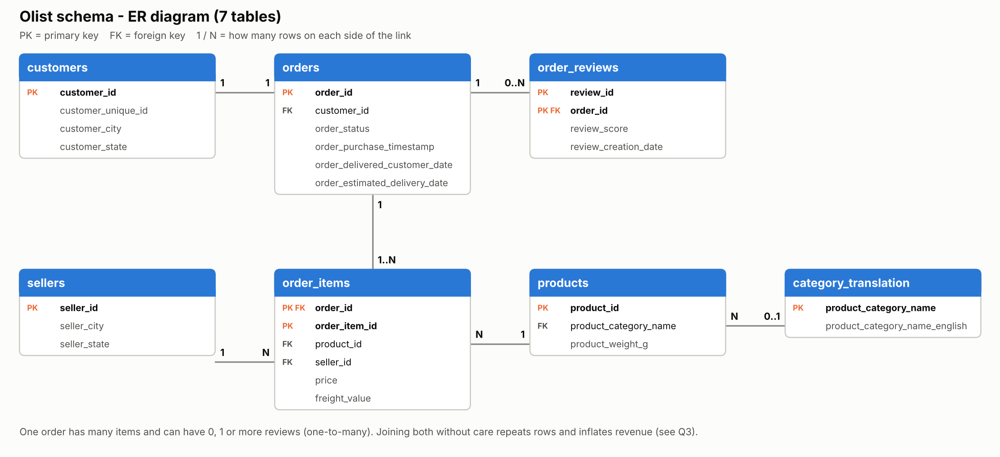

# End-to-End KPI Framework for E-Commerce Operations (SQL)

**Dataset:** [Olist Brazilian E-Commerce (Kaggle)](https://www.kaggle.com/datasets/olistbr/brazilian-ecommerce). I used 7 of its 9 CSV files.

## ER sketch and keys

| Table | Primary key | Foreign key |
|---|---|---|
| customers | customer_id | - |
| orders | order_id | customer_id |
| order_items | (order_id, order_item_id) | order_id, product_id, seller_id |
| order_reviews | (review_id, order_id) | order_id |
| products | product_id | product_category_name |
| sellers | seller_id | - |
| category_translation | product_category_name | - |

- One order can have many items and many reviews (one-to-many). This is what can inflate revenue in a join (see Q3).
- `review_id` repeats in the data, so the reviews key uses two columns.
- All keys match between tables, except 13 products whose category has no English name. That is why the category join is a LEFT JOIN.

## Analytical base view (`v_base`) and join choices

`v_base` is a SQL VIEW built as a chain of CTEs (`delivered_orders` → `order_lines` → `order_lines_category` → + `review_per_order`). It has **one row per item of a delivered order**, and every KPI query reads from it.

| Step | Join | Why this join type | Rows after |
|---|---|---|---|
| orders | filter `order_status = 'delivered'` | the task measures delivered orders only | 96,478 orders |
| + order_items | **INNER** | revenue lives on the items, so an order with no items has nothing to measure. It dropped 0 delivered orders. | 110,197 rows |
| + products | **LEFT** | keeps every item even if its product row were missing (0 were missing) | 110,197 |
| + category_translation | **LEFT** | 1,537 items have no category and 22 have a category with no English name (`pc_gamer`, `portateis_cozinha...`). INNER would silently drop their revenue. I used `COALESCE(english, portuguese, 'unknown')`. | 110,197 |
| + reviews (1 row per order) | **LEFT** | 646 delivered orders have no review. INNER would drop them and their revenue. Reviews are first grouped to one row per order (`AVG(review_score)`). | 110,197 |
| Q9: + sellers | **LEFT** | only adds seller city and state, and must not drop a seller | 2,970 sellers |
| B3: orders vs reviews | **anti-join** (`LEFT JOIN ... WHERE r.order_id IS NULL`) | the only way to keep the orders that have *no* match | 768 orders |

**HAVING thresholds:** Q7, Q8, Q10 and B4 rank or compare categories, so they keep only categories with at least 100 orders (`HAVING COUNT(DISTINCT order_id) >= 100`). Without this, a category with 2 orders could be "the worst" or "the best" by luck. Q9 ranks sellers by total revenue, which is a sum, so a tiny seller cannot reach the top by luck. That is why it needs no threshold, but a seller's average score should be read together with its `order_count`.

Because `v_base` is at item grain, every KPI query first groups it back to one row per order (or per order and category, or per order and seller) before averaging. Otherwise an order with 5 items would count 5 times in the delivery and review averages.

## Q3 - Revenue reconciliation

| Method | Revenue (BRL) | Rows | Difference vs (a) delivered |
|---|---|---|---|
| (a) `SUM(price)` on order_items, all statuses | 13,591,643.70 | - | +370,145.59 |
| (a) `SUM(price)` on order_items, delivered only | **13,221,498.11** | 110,197 | 0 |
| (b1) naive join with the raw reviews table | 13,279,836.59 | 110,840 | **+58,338.48** |
| (b2) `v_base` (reviews 1 row per order) | **13,221,498.11** | 110,197 | **0.00** |

**What caused the inflation:** the join to `order_reviews`. It is one-to-many with orders, so when an order has 2 reviews, every item of that order appears twice. 521 delivered orders have 2 reviews and 4 have 3. That gives 643 extra rows and exactly 57,827.06 + 511.42 = **58,338.48 BRL** of fake revenue (query Q3b proves it per review count).

**Fix:** group reviews to one row per order *before* joining (`GROUP BY order_id`). After the fix the base view matches the standalone sum to the cent.

The gap between 13.59M and 13.22M is not a join problem. It is the `delivered` filter: 370,145.59 BRL belongs to shipped, canceled and other orders.

## Core KPIs (Q4, delivered orders)

| KPI | Value | How |
|---|---|---|
| Total revenue | 13,221,498.11 BRL | `SUM(price)` (item price, freight not included) |
| Orders | 96,478 | |
| AOV | 137.04 BRL | revenue / number of orders |
| Avg delivery days | 12.56 | `julianday(delivered) - julianday(purchase)`, one value per order. 8 delivered orders have no delivered date and are left out of this average only. |
| Avg review score | 4.156 | one score per order |

### Why my numbers differ from the reference notes

The task's notes have slightly different numbers. I kept my own and checked where the differences come from:

- **13.59M revenue** is the all-status total. For delivered orders it is 13.22M (see Q3).
- **AOV 140.7** comes from dividing the all-status revenue by the delivered order count (13.59M / 96,478 = 140.88). Using the same base for both gives 137.04.
- **Review score 4.09** is the average of all review rows of all orders (4.086). Counting each delivered order once gives 4.156.
- **12.1 delivery days** matches an average over item rows with whole days (12.01). Counting each order once with exact times gives 12.56.
- **security_and_services 2.5 / fashion_childrens_clothes 4.5** are categories with only 2 and 7 orders. Q8's `HAVING COUNT(DISTINCT order_id) >= 100` removes them on purpose, so my lowest is `office_furniture` (3.643) and the highest is `books_general_interest` (4.535).
- **bed_bath_table 1.71M** I could not reproduce (price + freight over all statuses gives 1.24M). In my data it is 1.02M, the 3rd category. The top category is `health_beauty` (1.23M).
- **r = -0.43** looks like an order-level delay correlation. The task asks for a category-level one (Q10), which gives r = -0.58.
- **Top 10 sellers 12.7%**: I get 13.27% for delivered orders (Q9, `cumulative_share_pct`).

## Q10 - Delivery vs satisfaction

Across the 52 categories with 100+ orders, **r = -0.58**: categories that deliver more slowly get lower scores. `office_furniture` is the extreme point (20.64 days, 3.643). Without it r = -0.41, so the pattern is not driven by one category. This is a correlation between category averages. It shows a link, not proof of cause, but B2 points the same way at order level.

## Bonus

- **B1 VIEW:** `v_base` is a real VIEW, and Q4-Q10, B2, B4 and B5 all read from it.
- **B2 on-time rate:** 93.22% of orders arrived on or before the estimated date. On-time orders score 4.29, late orders 2.27.
- **B3 no review (anti-join):** 768 of 99,441 orders (0.77%) never got a review. For delivered orders it is 646 (0.67%).
- **B4 freight / revenue:** 8 of 52 categories have freight of 25% or more of item revenue (flag "shipping erodes margin"). The highest is `christmas_supplies` at 36.52%.
- **B5 share of monthly revenue:** `SUM() OVER (PARTITION BY month)` plus `LAG()` for the month-to-month change. `health_beauty` grew from about 6-9% in 2017 to 14.24% in 2018-08. `computers_accessories` peaked at 12.12% in 2018-02 and then fell to about 4.8%.

## 5 operational insights

1. **Late delivery is the biggest driver of bad reviews (B2).** 6.77% of delivered orders (6,534) arrived late. They score **2.27** on average, against **4.29** for on-time orders, and took 33.95 days. *Action:* warn the customer and the seller as soon as an order is at risk, and add buffer to estimates on slow routes.
2. **Peak season breaks delivery, and ratings follow (Q6).** Orders jumped from 4,478 in 2017-10 to 7,289 in 2017-11 (Black Friday). Delivery time went from 11.86 to 15.16 days and the score fell from 4.21 to 3.99. Feb-Mar 2018 was the worst period (16.95 / 16.30 days, scores 3.88 / 3.81). By 2018-08 delivery was 7.73 days with a 4.31 score. *Action:* book extra carrier capacity before November and for the months after the holidays.
3. **Slower categories get lower scores (Q10, Q8).** r = -0.58 across 52 categories. `office_furniture` is the worst: 20.64 days, score 3.643, 1,254 orders. *Action:* handle bulky categories as a separate logistics flow, with dedicated carriers and realistic estimates.
4. **A few sellers carry a lot of revenue, and some of them hurt the experience (Q9).** The top 10 of 2,970 sellers bring 13.27% of revenue. Seller #5 (`7c67e144...`, 973 orders) averages 22.34 delivery days and a 3.496 score, and seller #3 (`4a3ca931...`, 1,772 orders) scores 3.853. *Action:* key-account management with delivery SLAs for top sellers, starting with these two.
5. **Shipping eats the margin in some categories (B4).** 8 categories pay 25%+ of revenue in freight. `electronics` is the biggest of them (2,517 orders, 29.46%), and `office_furniture` is flagged too (25.01%). *Action:* free-shipping thresholds, bundling small items, or renegotiated freight rates for these categories.

## Charts

- `images/er_diagram.png` - ER diagram of the 7 tables
- `images/monthly_revenue_trend.png` - monthly revenue (Q6)
- `images/top_bottom_categories_revenue.png` - top 5 and bottom 5 categories by revenue (Q7)
- `images/delivery_vs_review_scatter.png` - delivery days vs review score per category with a trend line (Q10)
